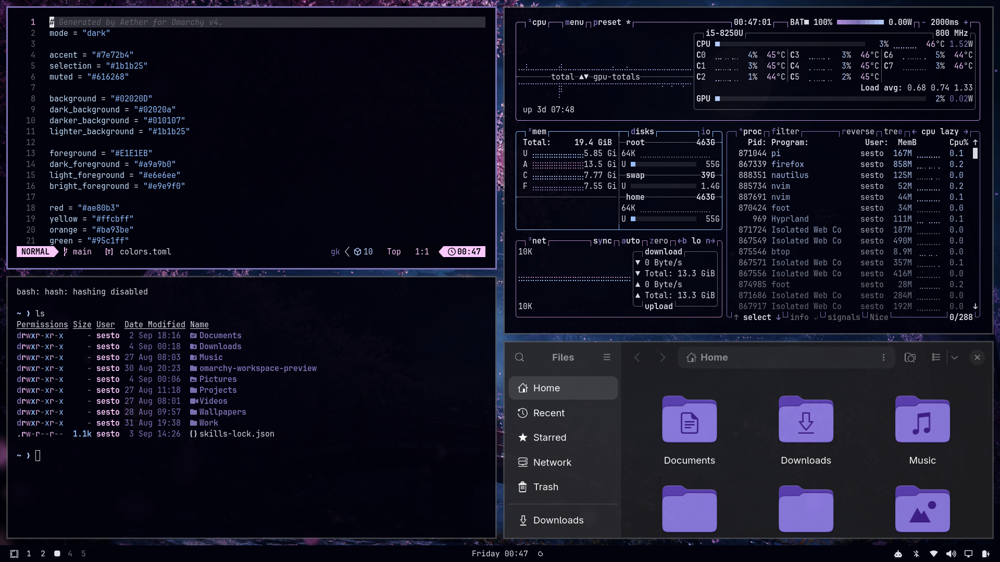

# Osaka Tree for Omarchy

A dark Omarchy theme built around a deep midnight background, soft violet accents, pale blue highlights, and matching Yaru Purple icons.



## Install

Open the Omarchy menu with `Super + Space`, choose **Install → Style → Theme**, and paste:

```text
https://github.com/AnoopLamba/omarchy-osaka-tree-theme
```

Or install it from a terminal:

```bash
omarchy theme install https://github.com/AnoopLamba/omarchy-osaka-tree-theme
```

To apply it again later:

```bash
omarchy theme set osaka-tree
```

Already installed an older version? Update third-party themes and select Osaka Tree again:

```bash
omarchy theme update
omarchy theme set osaka-tree
```

## What is included

- `colors.toml` — the shared Osaka Tree palette used by Omarchy's generated integrations
- `icons.theme` — matching Yaru Purple icons
- `backgrounds/` — four matching night wallpapers
- `preview.png` — desktop preview
- `LICENSE` — MIT license

Omarchy uses `colors.toml` to generate the theme for the shell, Hyprland, terminals, Neovim, Helix, btop, browsers, VS Code, and other supported applications.

## Palette

| Role | Color | Preview |
|---|---|---|
| Background | `#02020D` |  |
| Dark background | `#02020A` |  |
| Darker background | `#010107` |  |
| Lighter background | `#1B1B25` |  |
| Selection | `#1B1B25` |  |
| Foreground | `#E1E1EB` |  |
| Dark foreground | `#A9A9B0` |  |
| Light foreground | `#E6E6EE` |  |
| Bright foreground | `#E9E9F0` |  |
| Accent / Blue | `#7E72B4` |  |
| Muted | `#616268` |  |
| Red | `#AE80B3` |  |
| Yellow | `#FFCBFF` |  |
| Orange | `#BA93BE` |  |
| Green | `#95C1FF` |  |
| Cyan | `#B9D0FF` |  |
| Magenta | `#BD94E4` |  |
| Brown | `#705872` |  |
| Bright red | `#CA90D1` |  |
| Bright yellow | `#FFC5FF` |  |
| Bright green | `#9DD7FF` |  |
| Bright cyan | `#C9E4FF` |  |
| Bright blue | `#9484D5` |  |
| Bright magenta | `#D8A4FF` |  |

Created with Aether for Omarchy.
